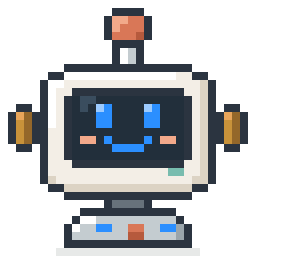

<!-- GitHub profile README. Proof over adjectives. -->
<picture><source media="(prefers-color-scheme: dark)" srcset="./assets/px-scale-dark.gif" /></picture>

#  Hey, I'm HJ Ding 👋

**AI Engineer · Open-Source Builder** 
Long-video Understanding / Multimodal Agents / Agentic RL

I build agent tooling that researchers run every day, and study how AI understands people in long video.

🎓 M.S. in Computer Science, **Shenzhen University** 
Graduating 2028 · looking for **engineering internships** in agents, developer tooling and applied AI.

✉️ <a href="mailto:2510813014@mails.szu.edu.cn">Email</a> · <a href="https://www.linkedin.com/in/%E6%B3%93%E6%99%AF-%E4%B8%81-b014a23ba/">LinkedIn</a> · <a href="https://x.com/dahuoji09">X</a> · <a href="https://917dhj.github.io/DeepPaperNote/">DeepPaperNote site</a>

## &nbsp;&nbsp;What I ship

&nbsp;**<a href="https://github.com/917Dhj/DeepPaperNote">DeepPaperNote</a>** &nbsp; &nbsp;MIT · Obsidian + Zotero

*The single-paper ingestion layer for an LLM-maintained academic wiki.*

Most paper-reading agents hand you a prettier summary. DeepPaperNote keeps the evidence — the research question, the method chain, the formulas, the figure context, and the boundary of what the paper actually showed — and writes it as an Obsidian page a human will reopen and an agent can reuse. It ships as one plugin across Claude Code, Codex, Cursor, Copilot and Gemini CLI.

<code>claude plugin marketplace add 917Dhj/DeepPaperNote</code> · <a href="https://917dhj.github.io/DeepPaperNote/">Website</a> · <a href="https://github.com/917Dhj/DeepPaperNote">Repository</a> · <a href="https://github.com/917Dhj/DeepPaperNote/releases">Releases</a>

&nbsp;**<a href="https://github.com/917Dhj/dkitchen">dkitchen</a>** &nbsp;PyPI 0.5.8 · 17 releases · MIT

*Your agents run the kitchen; you stay the head chef.*

The bottleneck in agent-run research is not execution — it is that you become the message bus. dkitchen gives every session a station, routes work through GitHub issues as tickets, puts a verifier between a plan and the GPU bill, and wakes a session back up when its long job finishes (`ding`). Nothing moves without your approval, in your own words.

<code>pip install dkitchen</code> · <a href="https://pypi.org/project/dkitchen/">PyPI</a> · <a href="https://github.com/917Dhj/dkitchen">Repository</a> · <a href="https://github.com/917Dhj/dkitchen/blob/main/docs/ding.md">Docs</a>

&nbsp;**<a href="https://github.com/GML-MMGroup/Diverter">Diverter</a>** &nbsp;Codex plugin · MIT · GML-MMGroup

*One task in. The right subagents out.*

A coding agent does better on a big task when it hands pieces to specialist subagents, but Codex only plans that split for you in its Ultra mode. Diverter brings the same planning to everyday sessions: it decides when a task can split, routes each piece to the right specialist role, keeps the main thread on the critical path, and steps aside whenever Codex is already delegating on its own. Backed by 60+ automated tests and real subagent-lifecycle runs.

<a href="https://github.com/GML-MMGroup/Diverter">Repository</a>

&nbsp;**<a href="https://github.com/917Dhj/DraftBar">DraftBar</a>** &nbsp;macOS · Swift + SwiftUI · v2.0.3 · MIT

*The note you would otherwise lose between two apps.*

A native menu-bar scratchpad: pull it out, type, and the draft lands in a plain `note.md` on disk. No Electron, no account, no sync ceremony — the constraint is the feature.

<a href="https://github.com/917Dhj/DraftBar/releases/latest">Download</a> · <a href="https://github.com/917Dhj/DraftBar">Repository</a>

Also: <a href="https://github.com/917Dhj/DeepPaperNote-Connector">DeepPaperNote Connector</a> — a Chrome extension that drops paper PDFs into your Obsidian library, so the source and the note stay together.

## &nbsp;&nbsp;Toolbox

**Day to day** &nbsp;Python · PyTorch · Claude Code · Codex · MCP 
**Depth** &nbsp;agent orchestration · retrieval pipelines · plugin and skill packaging 
**Also ship in** &nbsp;Swift / SwiftUI · TypeScript · Java 
**Ops** &nbsp;Linux + GPU boxes · GitHub Actions · PyPI and release engineering

## &nbsp;&nbsp;Open to

**Engineering internships in agents, developer tooling and applied AI.** The part I like is turning agent ideas into tools people run every day: orchestration, retrieval, packaging, and the plumbing that keeps long jobs moving without a human playing message bus. If your team is hiring for that, [email me](mailto:2510813014@mails.szu.edu.cn) or find me on [LinkedIn](https://www.linkedin.com/in/%E6%B3%93%E6%99%AF-%E4%B8%81-b014a23ba/).

Also glad to argue about how agent sessions should hand off work, or to hear where [DeepPaperNote](https://917dhj.github.io/DeepPaperNote/) got your field wrong.

<code>&gt;</code>&nbsp;

